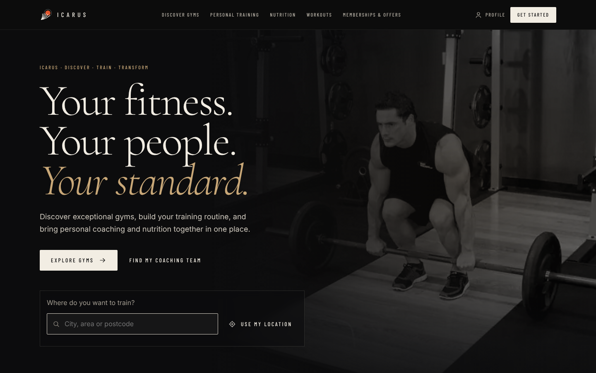
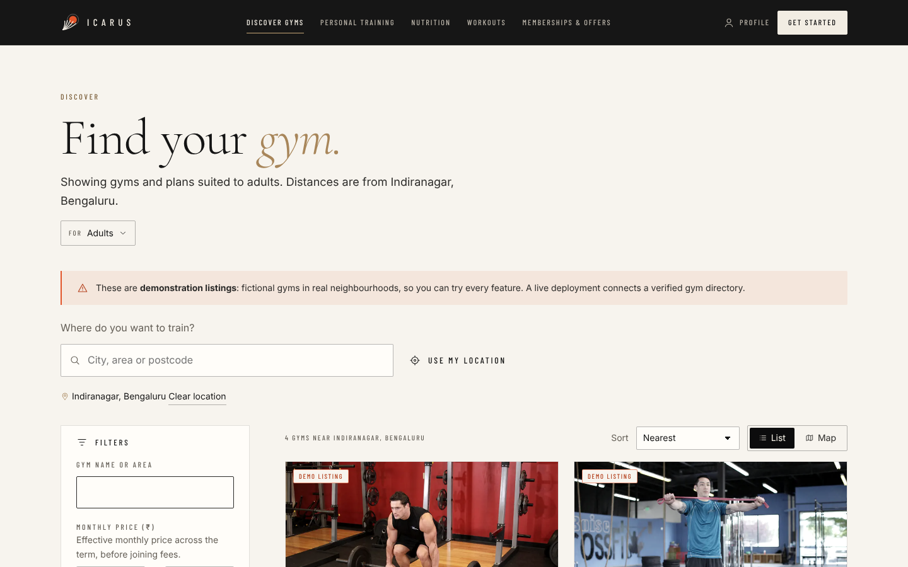
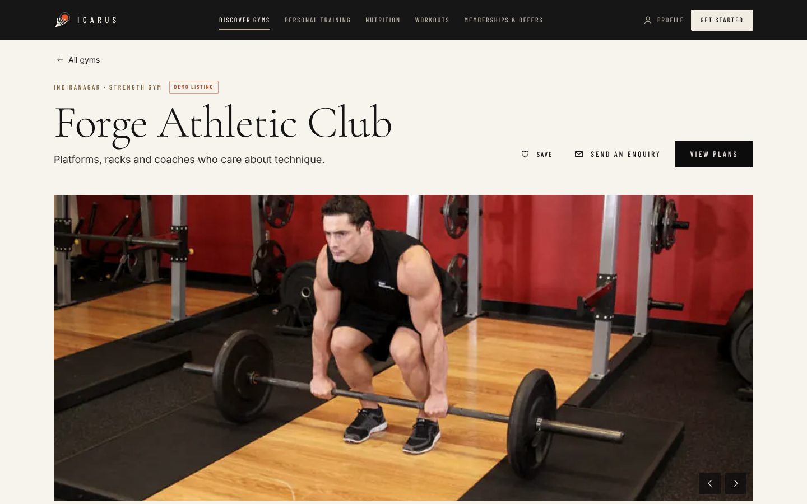
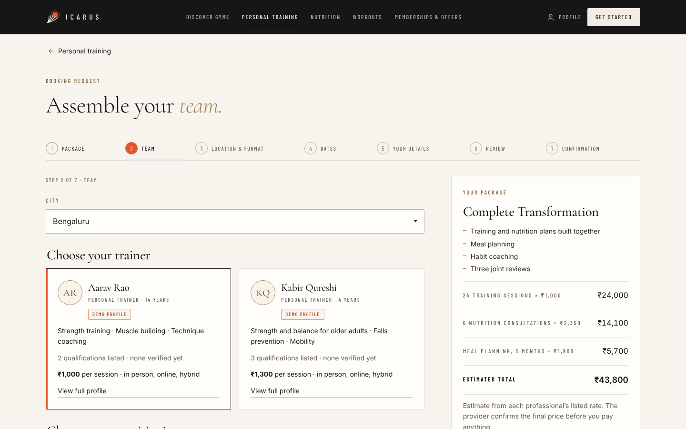
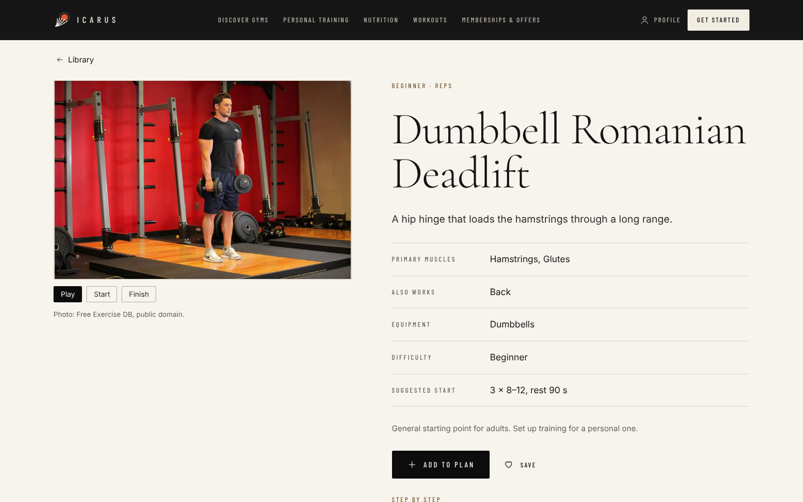
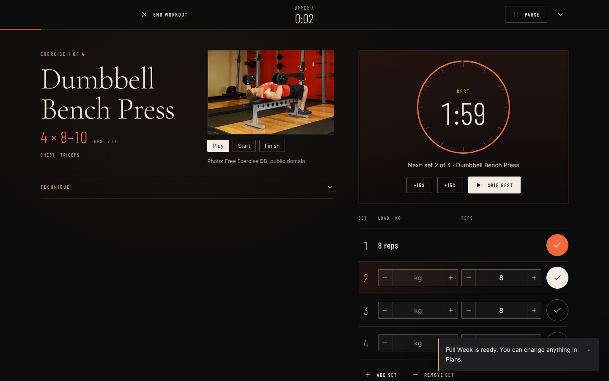
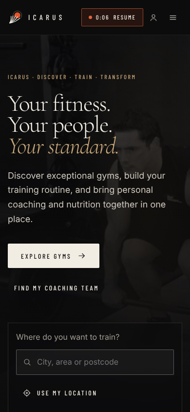

# Icarus

**Discover gyms. Build your coaching team. Train with a plan.** Icarus brings three things together in one place:

- **Discover:** find gyms near you, filter by price, facilities, hours and suitability, and compare memberships by their real terms.
- **Train:** follow a weekly programme with guided sessions, a rest clock that never loses count, real photographic exercise demonstrations and an AI coach.
- **Transform:** book a personal trainer and a nutritionist together in a single package request.

Everything adapts to who is training: **Kids**, **Adults** or **Older Adults**.

> **Demonstration data.** This build ships with fictional gyms, trainers, nutritionists, prices and offers set in real neighbourhoods of Bengaluru, Mumbai, New Delhi and Hyderabad. They are labelled **Demo** everywhere they appear. Icarus does not take payments, and it never marks a booking as confirmed: requests are recorded and, when you configure it, forwarded to the provider. See [What is needed to go live](#what-is-needed-to-go-live).



## What you can do

**First visit.** Choose who you are exploring for. The choice shapes every list, and you can change it from the menu at any time.

- **Kids (5–17).** Supervised, play-based programmes only. A parent or guardian makes every request and gives consent; Icarus never asks for a child's name. No weight-loss programmes, calorie targets, nutrition consultations or meal plans.
- **Adults (18–64).** The full range of gyms, programmes, coaching and nutrition.
- **Older Adults (65+).** Balance, mobility and moderate strength work, accessible facilities and safety guidance.

**Gym discovery.** Search by city, area or postcode, or share your device location (asked first, rounded to about 1 km, kept on your device). Filter by name, distance, monthly price range, membership duration, gym type, facilities, opening hours, classes, trainer availability, step-free access and verified ratings. Results show as a list or a map. Each gym page has a captioned gallery, location and directions, facilities, equipment, classes, accessibility, trainers and nutritionists, policies, and reviews from verified sources only (none in the demo data, so none are shown).

**Memberships and offers.** Every plan shows its total, effective monthly price, payment schedule, joining fee, deposit, inclusions, personal training sessions, renewal and cancellation terms, and any offer with its end date. Durations of 1, 2, 3, 6, 9, 10 and 12 months. Compare two durations at one gym, or up to four plans across gyms. Savings appear only when they follow from the gym's own one-month price; there are no "best value" labels.

**Coaching packages.** Fitness Essentials, Strength & Performance, Complete Transformation and Premium Personal Coaching for adults, plus Young Athlete Foundations (kids) and Active Ageing (older adults). A seven-step request: package, team, location and format, dates, your details, review, confirmation. The estimate is built from each professional's listed rate and recomputed on the server. Qualifications show whether they are verified.

**Nutrition.** General education kept visibly separate from personalised advice, dietary preferences, a weekly meal organiser for your own notes, nutritionist profiles and your consultation requests. Safeguards for children, medical conditions and disordered eating are on the page, not in the small print.

**Exercise library.** 74 exercises across chest, back, shoulders, arms, legs, glutes, core, full body, cardio, mobility, bodyweight and equipment, with kids and older-adult categories. Each has real start and finish photographs (playable, or stepped by hand), step-by-step instructions, coaching cues, common mistakes, easier and harder variations, safety notes, a suggested starting dose and Add to plan. Search, filter, sort and save.

**Workouts.** A five-step set-up builds a programme around your goal, experience, equipment and schedule. Guided sessions log load and reps per set, run rest and hold timers that stay correct when you leave the screen or reload, and can be paused and resumed. History, streaks, personal bests and weekly charts follow from what you actually logged.

**AI coach.** Ask for a session, a weekly split, substitutions or technique help. Works offline out of the box; connect Claude or OpenAI for open-ended conversation. Replies are validated and rendered as text, never HTML. See [docs/AI_PROVIDERS.md](docs/AI_PROVIDERS.md).

**Your profile.** There are no accounts yet, and Icarus does not pretend otherwise: your profile, saved items, comparison, requests, meal notes and training history live in this browser. Review, export or erase them at any time.

| Gym discovery | Gym and memberships | Coaching request |
|---|---|---|
|  |  |  |

| Exercise demonstration | Guided workout | Phone |
|---|---|---|
|  |  |  |

## Quick start

Requires **Node.js 22.18 or later**.

```sh
npm ci
npm start
```

Open http://127.0.0.1:4319. No account, key or database is needed.

## Configuration

Copy `.env.example` to `.env`. Every setting is optional; restart the server after editing it.

| Variable | Purpose |
|---|---|
| `PORT` | Port to listen on (default `4319`). |
| `HOST` | Interface to bind (default `127.0.0.1`). Anything other than loopback requires `ALLOWED_HOSTS`. |
| `ALLOWED_HOSTS` | Comma-separated public host names the server answers to. |
| `TRUST_PROXY` | `1` to read the client address from `X-Forwarded-For` behind a trusted proxy (used for rate limits). |
| `AI_REQUESTS_PER_10_MIN` | AI coach requests per client address per 10 minutes (default 40). |
| `ANTHROPIC_API_KEY`, `ANTHROPIC_MODEL` | Claude through the Anthropic API (default model `claude-opus-5-5`). |
| `OPENAI_API_KEY`, `OPENAI_MODEL` | OpenAI Responses API (default model `gpt-6-astra`). |
| `CLAUDE_CLI_PATH`, `CLAUDE_MODEL` | Claude Code CLI with your existing login. |
| `CODEX_CLI_PATH`, `CODEX_MODEL` | Codex CLI with your existing login. |
| `DATA_DIR` | Where enquiries and booking requests are stored (default `data/runtime`, git-ignored). |
| `REQUEST_RETENTION_DAYS` | Requests are deleted after this many days (default 90). |
| `REQUEST_WEBHOOK_URL` | HTTPS endpoint that receives each new request, for your CRM or a provider integration. |
| `MAP_TILE_URL`, `MAP_ATTRIBUTION` | HTTPS tile server for the gym map. Without it the map view draws a to-scale position plot and says so. |
| `SUPPORT_EMAIL` | Contact address shown in the footer, privacy notice and support page. |

## Development

```sh
npm run build        # compile TypeScript; copy styles, fonts, photos and static files to dist/
npm start            # build, then run the server
npm run typecheck
npm run lint         # static safety checks (no innerHTML/eval, no server env in browser code)
npm test             # unit and HTTP tests (node:test)
npm run check        # typecheck + lint + tests
npm run test:ui      # browser tests, including journeys A–E (Playwright, own server on port 4320)
```

Browser tests need a Chromium for Playwright (`npx playwright install chromium`), or set `PLAYWRIGHT_CHROME_PATH`. `CAPTURE_SCREENSHOTS=1 npm run test:ui` refreshes `docs/screenshots/`. `node scripts/generate-demo-data.mjs` rebuilds the demo dataset; `scripts/fetch-exercise-media.py` re-downloads the exercise photographs and instructions.

The server keeps built files in memory, so restart it after rebuilding.

## How it is built

Plain TypeScript and ES modules, no front-end framework and no bundler; one runtime dependency (`@anthropic-ai/sdk`). Domain logic (exercises, programmes, workout engine, pricing, search, request validation, audience rules) lives in `src/shared`, runs in the browser and on the server, and is unit-tested. The marketplace data source sits behind a `MarketplaceProvider` interface, so the demo dataset can be replaced by a live directory without touching screens.

- [docs/ARCHITECTURE.md](docs/ARCHITECTURE.md): module map, data flow, API and security model.
- [docs/DESIGN.md](docs/DESIGN.md): design language and tokens.
- [docs/DEPLOYMENT.md](docs/DEPLOYMENT.md): production set-up, database and external services.
- [docs/PRIVACY.md](docs/PRIVACY.md): what is collected, where it is kept, safeguards for children.
- [docs/ASSETS.md](docs/ASSETS.md): where every image, font and dataset comes from, and its licence.

## What is needed to go live

This repository is a working product with demonstration data. It is not a live service. Before real people rely on it:

1. **Real listings.** Replace `DemoProvider` with a provider backed by verified gyms and professionals (your own database or a partner API). Only that source may set `demo: false`.
2. **Request handling.** Set `REQUEST_WEBHOOK_URL` so requests reach providers, or connect a booking system. Until a provider confirms, requests must stay "received" or "sent to the provider".
3. **Accounts.** Add authentication before storing anything server-side per person; `Repository` is already behind a storage interface.
4. **Payments.** None are taken today. Add a payment provider only together with confirmed bookings, refunds and receipts.
5. **Verification and reviews.** Check qualifications with their issuers before marking them verified; show ratings only from a verified review source.
6. **Licensed photography of real venues**, children and older adults, with model releases (see [docs/ASSETS.md](docs/ASSETS.md)).
7. **Legal review** of the privacy notice, terms, child-safety process and data retention for the countries you operate in. The pages in the app describe how the software behaves; they are not a statement of compliance.

Details in [docs/DEPLOYMENT.md](docs/DEPLOYMENT.md).

## Security

- Loopback by default; host, origin and per-process token checks; a static file allow-list; strict Content Security Policy.
- API keys stay in the server environment and never reach the browser, logs or error messages. Request message content is never logged.
- Location access is allowed for this site only (`Permissions-Policy: geolocation=(self)`), requested only after the person presses "Use my location", and rounded before use.
- Booking requests are validated with a strict schema on the server, priced from the listing (never from the client), rate limited (10 per 10 minutes per address), protected by a honeypot, stored with owner-only file permissions, and readable only with a per-request token whose hash is stored.
- **There is no user authentication.** Anyone who can reach the server can use its AI providers within the rate limit. For public deployments see [docs/DEPLOYMENT.md](docs/DEPLOYMENT.md).

Icarus gives general fitness and nutrition information, not medical advice. Stop exercising and seek help if you feel pain, dizziness or chest discomfort.

## Limitations

- Demonstration listings only, in four cities; the gym map needs a configured tile server for street maps.
- No accounts, sync or payments (by design, until the steps above are done).
- No licensed photographs of children or older adults were available; their audience cards use a typographic design instead, and exercise photos show adult models.
- AI providers were exercised only through test doubles while building this version; verify with your own keys.

## Licence

No licence has been chosen yet. Parts of the server (the subprocess runner, credential redaction, lint script and the original shape of the provider adapters) came from a starter project supplied by a third party; confirm you hold the rights to that code before publishing under an open-source licence. Exercise photographs and instructions are public domain (Free Exercise DB, Unlicense); fonts are under the SIL Open Font License. See [docs/ASSETS.md](docs/ASSETS.md).
