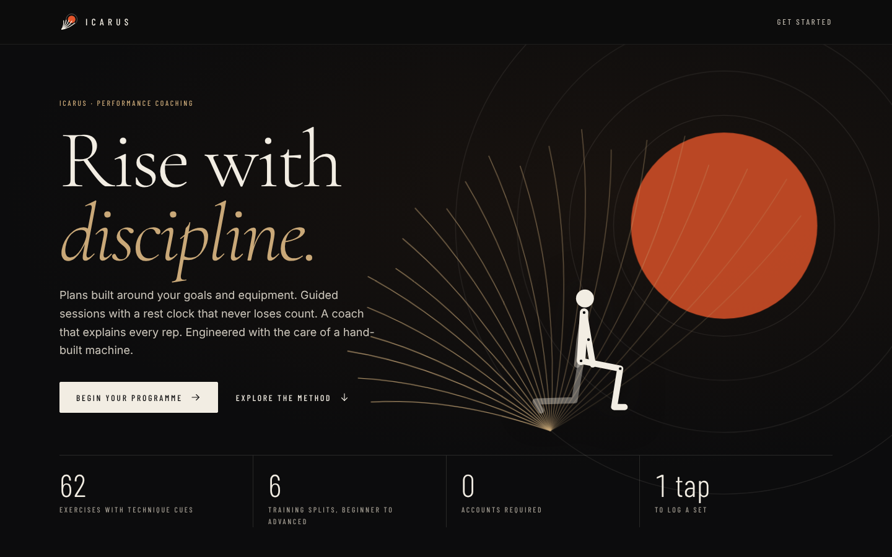
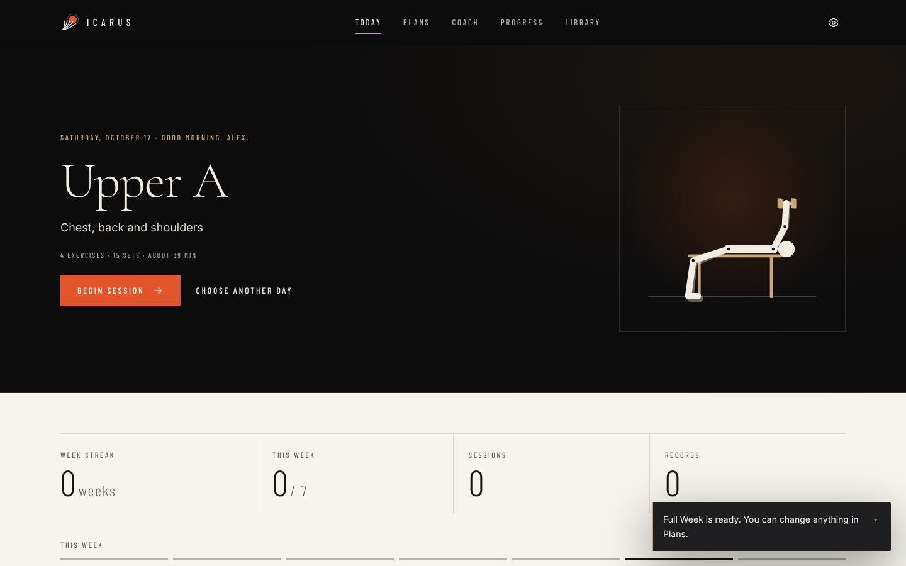
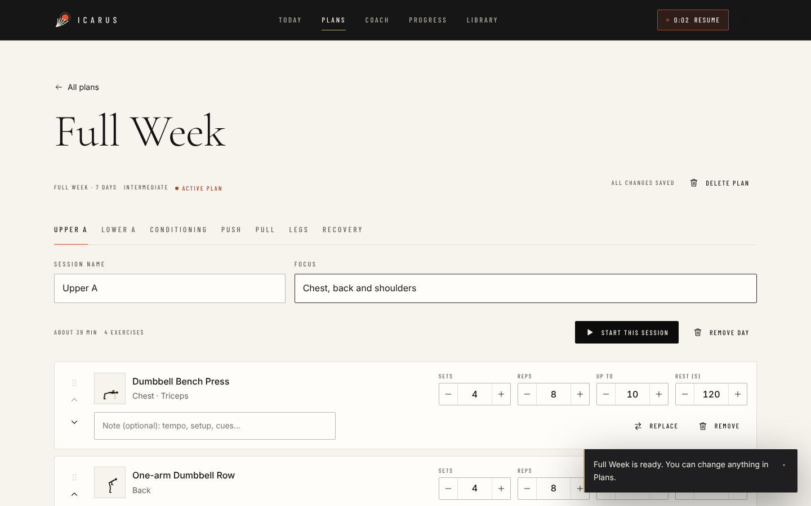
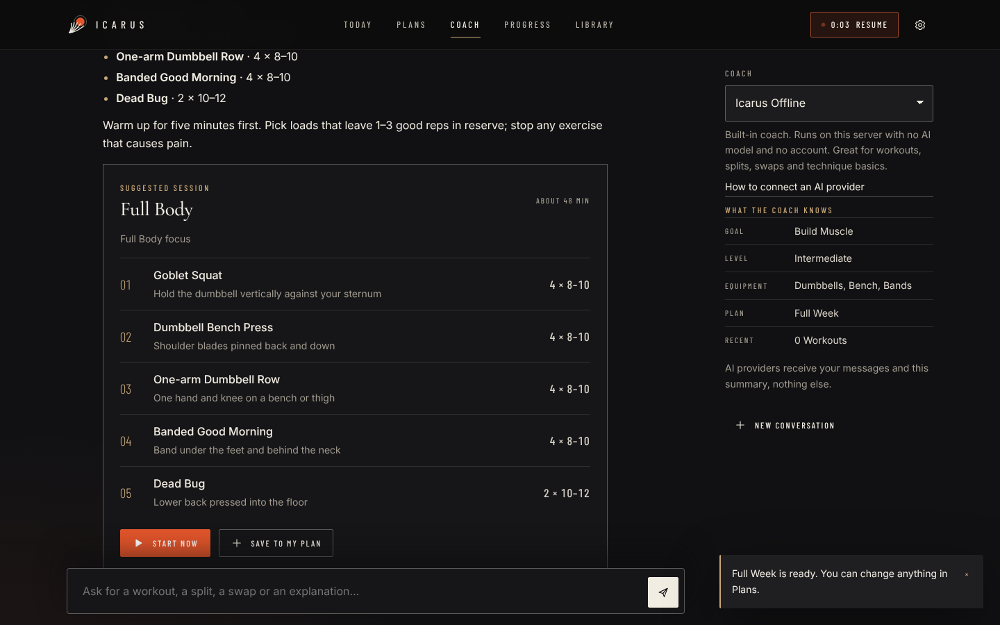
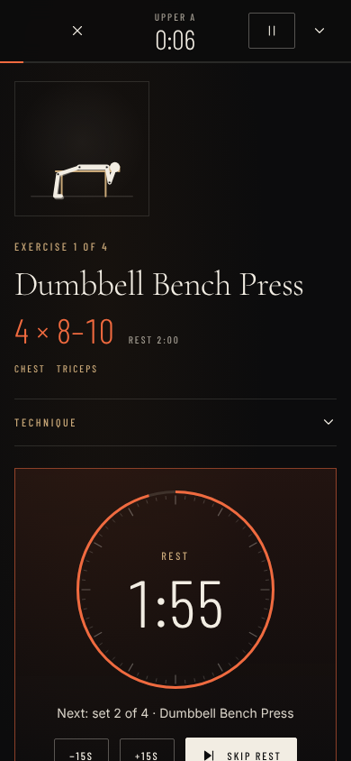

# Icarus

**Premium fitness coaching that runs on your own machine.** Icarus builds a training plan around your goal, experience, equipment and schedule, guides you through every session with set tracking and a rest clock that never loses count, records your history and personal bests, and answers training questions through a built-in coach or the AI provider of your choice.



## Features

- **Onboarding in five steps.** Goal, experience, equipment, schedule and units, each with a short explanation of why it matters. Everything can be changed later.
- **Plans.** Six templates (full body 3-day, upper/lower 4-day, push/pull/legs 3- and 6-day, 5-day hybrid, and a full week with recovery days), each generated for beginner, intermediate or advanced lifters and trimmed to your session length. The plan builder adds, removes, reorders (buttons or drag) and replaces exercises, and edits sets, rep ranges, timed holds, rest and notes. Changes save automatically.
- **Today.** The next session in your rotation, or a rest-day recovery option; your week at a glance, weekly streak, recent workouts, personal bests and a recovery note based on what you logged in the last 48 hours.
- **Guided workouts.** Animated demonstration, targets, technique cues and common mistakes for each exercise. Log load and reps per set (pre-filled from last time), add or remove sets, run timed holds, and get an automatic rest timer with −15 s / +15 s / skip. Pause the whole session, move between exercises, and leave the screen: timers keep correct time and the workout survives reloads. Keyboard shortcuts for desktop, screen wake lock on supported phones, and optional chimes and vibration.
- **Summaries and progress.** Duration, sets, reps, volume and new personal bests after each session; weekly charts, a training calendar, full history and a records table.
- **Exercise library.** 62 exercises with demonstrations, cues, mistakes and alternatives for your equipment.
- **Coach.** Ask for a session for any muscle group, a weekly split, substitutions, or explanations of sets, reps, rest and technique. Suggested sessions start with one tap or save into your plan; suggested splits become editable plans. Warning symptoms (pain, dizziness, chest tightness) get a stop-and-seek-help answer and no workout.
- **Your data.** Stored in this browser only, with export, import and delete-everything in Settings.

| Today | Workout | Plan builder |
|---|---|---|
|  |  |  |

| Coach | Exercise detail | Phone |
|---|---|---|
|  |  |  |

## Quick start

Requires **Node.js 22.18 or later**.

```sh
npm ci
npm start
```

Open http://127.0.0.1:4319. No account or key is needed: the built-in offline coach works out of the box. To use a different port, set `PORT` in `.env`.

## Configuration

Copy `.env.example` to `.env`. Every setting is optional.

| Variable | Purpose |
|---|---|
| `PORT` | Port to listen on (default `4319`). |
| `HOST` | Interface to bind (default `127.0.0.1`). Anything other than loopback requires `ALLOWED_HOSTS`. |
| `ALLOWED_HOSTS` | Comma-separated public host names the server answers to. |
| `TRUST_PROXY` | `1` to read the client address from `X-Forwarded-For` behind a trusted proxy (used for rate limiting). |
| `AI_REQUESTS_PER_10_MIN` | AI coach requests allowed per client address per 10 minutes (default 40). |
| `ANTHROPIC_API_KEY`, `ANTHROPIC_MODEL` | Claude through the Anthropic API (default model `claude-opus-5-5`). |
| `OPENAI_API_KEY`, `OPENAI_MODEL` | OpenAI Responses API (default model `gpt-6-astra`). |
| `CLAUDE_CLI_PATH`, `CLAUDE_MODEL` | Claude Code CLI with your existing login. |
| `CODEX_CLI_PATH`, `CODEX_MODEL` | Codex CLI with your existing login. |

Each AI provider turns on when its key or path is set; restart the server after editing `.env`. See [docs/AI_PROVIDERS.md](docs/AI_PROVIDERS.md) for what each provider receives, how replies are validated, and the safety limits on the CLI providers.

## Development

```sh
npm run build        # compile TypeScript and copy styles, fonts and static files to dist/
npm start            # build, then run the server
npm run typecheck
npm run lint         # static safety checks (no innerHTML/eval, no server env in browser code)
npm test             # unit and HTTP tests (node:test)
npm run check        # typecheck + lint + tests
npm run test:ui      # end-to-end browser tests (Playwright, starts its own server on port 4320)
```

Browser tests need a Chromium for Playwright 1.56 (`npx playwright install chromium`), or set `PLAYWRIGHT_CHROME_PATH` to an installed Chrome. `CAPTURE_SCREENSHOTS=1 npm run test:ui` refreshes the images in `docs/screenshots/`.

The server reads built files once and keeps them in memory, so restart it after rebuilding. Prompt and skill files (`prompts/system.md`, `skills/workout.md`) are re-read when they change.

## Architecture

Plain TypeScript and ES modules, no front-end framework and no bundler; one runtime dependency (`@anthropic-ai/sdk`). Shared domain logic (exercise catalog, plan generator, workout engine, statistics, storage) runs in both the browser and the server and is unit-tested. See [docs/ARCHITECTURE.md](docs/ARCHITECTURE.md) for the module map, decisions and security model, and [docs/DESIGN.md](docs/DESIGN.md) for the design system.

## Deployment

Icarus is designed as a single-person app. To run it on a server:

1. `npm ci && npm run build` (fonts and TypeScript are dev dependencies needed at build time).
2. Run `node --env-file=.env dist/server/main.js` under a process manager.
3. Put it behind an HTTPS reverse proxy. Set `HOST=127.0.0.1` if the proxy is on the same machine, or `HOST=0.0.0.0` with `ALLOWED_HOSTS=your.domain`. Set `TRUST_PROXY=1` only when a trusted proxy sets `X-Forwarded-For`.
4. `GET /api/health` returns `{ "ok": true }` for health checks.

**There is no user authentication.** Anyone who can reach the server can use its AI providers on your account (within the rate limit). For anything beyond personal use, put it behind an authenticating proxy, or leave AI keys unset so only the offline coach is available. Do not enable the CLI providers on a shared or public server.

## Security and privacy

- Workout data lives in your browser's local storage. It is not synced between devices or browsers and is lost if site data is cleared: export backups from Settings.
- API keys stay in the server's environment; the browser never receives them.
- Coach replies are validated against a schema and rendered as text, never as HTML.
- More detail in [docs/ARCHITECTURE.md](docs/ARCHITECTURE.md#security-model).

Icarus gives general fitness guidance for healthy adults. It is not medical advice. Stop exercising and seek help if you feel pain, dizziness or chest discomfort.

## Limitations and next steps

- **Single device, single person.** No accounts or sync yet. `Repository` is behind a key-value interface so a server-backed store can be added.
- **AI providers were not exercised live** while building this version (no network access to the providers). The adapters are tested with fake transports; verify with your own keys.
- **Exercise figures are schematic** side-view drawings, not video. Some movements share a pattern (for example, all rows use the same figure).
- Possible next steps: accounts and sync, progression suggestions per exercise, plate calculator, offline install (service worker), exporting history as CSV, more exercises and demonstrations.

## Licence

No licence has been chosen yet. Parts of the server (the subprocess runner, credential redaction, lint script and the original shape of the provider adapters) came from a starter project supplied by a third party; confirm you hold the rights to that code before publishing under an open-source licence. Bundled fonts (Cormorant Garamond, Barlow Condensed, Inter) are under the SIL Open Font License; their licence texts are copied to `dist/web/fonts/LICENSES.txt` at build time.
